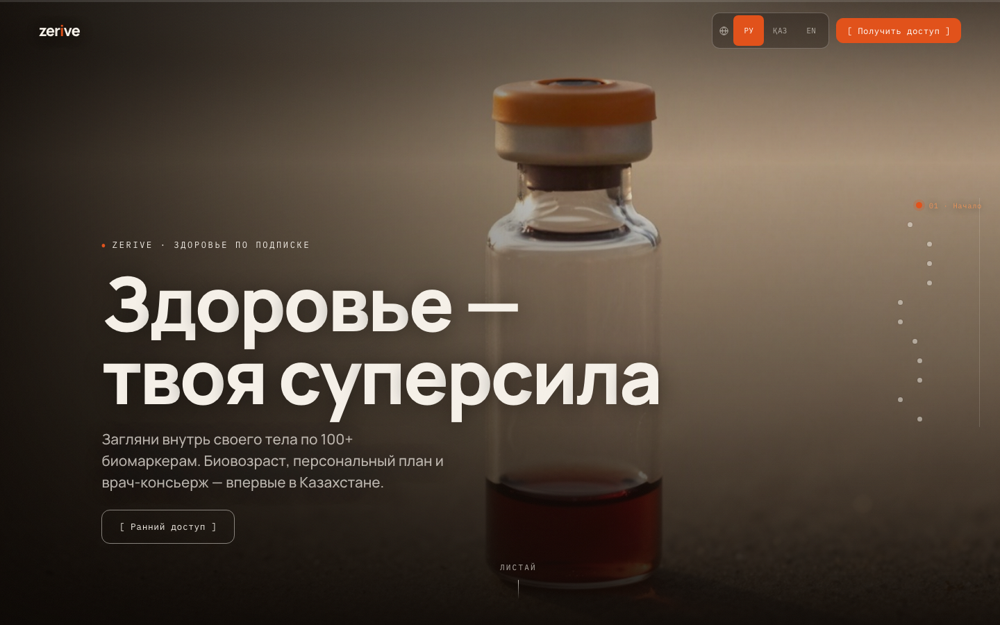
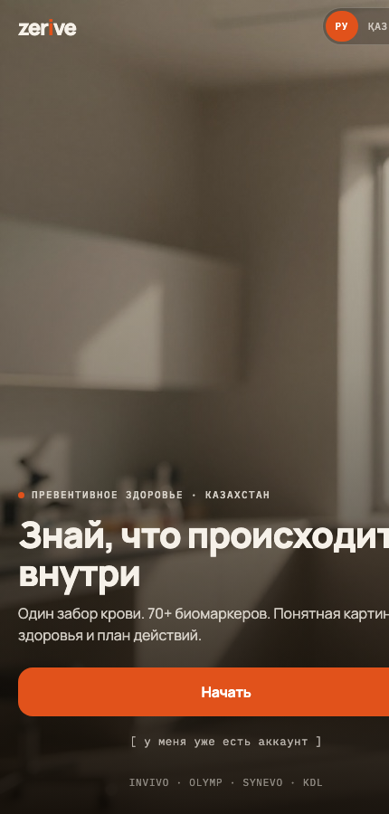
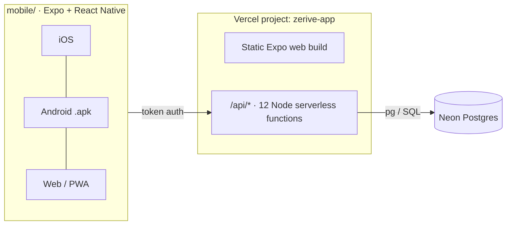

<div align="center">

# ZERIVE

### Preventive health for Kazakhstan: one blood draw, 70+ biomarkers, and a plan you can actually follow

ZERIVE turns lab results into a clear picture of your health. You get a **ZERIVE Score**, your **biological age**, a breakdown across 8 body systems, a personal action plan, and trends every time you retest.

[](https://zerive-app.vercel.app)
[](https://zerive.vercel.app)


</div>

---

<p align="center">
  
  &nbsp;
  
</p>

## The idea

People usually do blood tests only when something already hurts. They get back a PDF full of numbers with no context. ZERIVE flips that around:

> **Get tested → understand your body → follow a personal plan → retest → see the progress.**

The business model follows US preventive-health subscriptions such as Superpower, and the data UX takes cues from Ornament. Everything is adapted for Kazakhstan: local partner labs, local pricing, and full **Russian / Kazakh / English** support.

## ✨ Features

| | |
|---|---|
| 🧮 **ZERIVE Score & biological age** | One number for overall health, plus biological age compared with real age |
| 🫀 **8 body systems, 73 biomarkers** | Heart, metabolism, hormones, inflammation, nutrients, liver, kidneys, blood, each shown as a progress bar |
| 📈 **Biomarker deep-dives** | Range track with an *optimal* band (not just "normal"), trend across check-ups, and what it is / why it matters / what to do |
| ✅ **Personal plan** | Priorities generated from your weakest markers, with a checklist synced to the server |
| 💬 **Grounded AI assistant** | Answers from **your actual numbers** ("what changed?", "why am I tired?"). It is rule-based, so it never invents values |
| 🧪 **Check-up flow** | Pick lab, city and date → QR code → upload results (PDF, photo or manual entry) |
| 🗄️ **Health vault** | Documents and the history of every check-up |
| 🌍 **RU / KK / EN** | Type-safe i18n catalog, and all medical content is trilingual |

## 🏗️ Architecture

**One Expo codebase ships to iOS, Android and Web/PWA.** The web build and the API deploy together as a single Vercel project.



- **Truly multi-user.** Each phone number gets its own isolated account. A purchased check-up generates a personal panel (scores, statuses, biological age, plan and documents) with a deterministic per-user generator. Retests add new measurements, and those measurements drive the trends.
- **Offline fallback.** The app reads from the API and falls back to a static dataset when offline. The same dataset generates the database seed (`server/gen-seed.mjs → seed.sql`), so the two never drift apart.
- **Secure sessions.** Phone → OTP → session token, stored only as a SHA-256 hash with a 90-day TTL. Secrets live only in Vercel environment variables.
- **One design system.** The whole theme comes from a single token file (`mobile/src/theme/tokens.ts`). The interface passed an audit for WCAG AA contrast and accessibility labels.

### Data model

`body_systems (8)` → `biomarker_catalog (73, trilingual, reference + optimal ranges)`
`users` → `profiles` · `sessions` · `checkups` → `biomarker_results` + `system_scores`
`documents` · `plan_priorities` → `plan_steps` → `plan_progress`

### API

| Method | Path | Purpose |
|---|---|---|
| POST | `/api/auth/request-otp` · `/api/auth/verify-otp` | Phone sign-in |
| GET / PUT | `/api/me` · `/api/profile` | Profile & onboarding |
| GET | `/api/report` | Dashboard: score, systems, counts |
| GET | `/api/biomarkers` · `/api/biomarker/[id]` | Markers with trends |
| GET / POST | `/api/plan` · `/api/plan/toggle` | Personal plan |
| GET | `/api/documents` | Health vault |
| POST | `/api/checkout/complete` | Generate a personal check-up |
| POST | `/api/ai` | Grounded answer from the user's data |

## 🚀 Try it

Open **[zerive-app.vercel.app](https://zerive-app.vercel.app)** (installable as a PWA on iOS and Android).
Demo sign-in: phone `701 234 56 78`, then **any 4-digit code**. It opens a demo account with three check-ups, so you can see trends right away.

## 🛠️ Run locally

```bash
cd mobile
npm install
npx expo start          # press i / a, or --web
```

Backend and database:

```bash
# Create a Neon (or any Postgres) database, then:
psql "$DATABASE_URL" -f server/schema.sql
node server/gen-seed.mjs && psql "$DATABASE_URL" -f server/seed.sql
```

## 📁 Repository layout

```
ZERIVE/
├─ landing/     marketing site (separate Vercel project)
├─ mobile/      Expo app: iOS + Android + Web/PWA
│  └─ src/      app routes · theme tokens · i18n · data · stores · UI kit
└─ server/      schema.sql · seed generator · 12 serverless API functions
```

## 🗺️ Roadmap

- [ ] Real PDF/photo parsing of lab reports into `biomarker_results`
- [ ] SMS OTP (Mobizon/SMSC), Apple & Google sign-in
- [ ] Kaspi payments for check-ups
- [ ] Optional LLM assistant on top of the grounded rule engine
- [ ] Retest reminders (push notifications) and an iOS build via EAS

## 📄 License

[MIT](LICENSE) © 2026 Alan Bai

<sub>Medical disclaimer: ZERIVE is an informational wellness product and does not replace a doctor.</sub>
